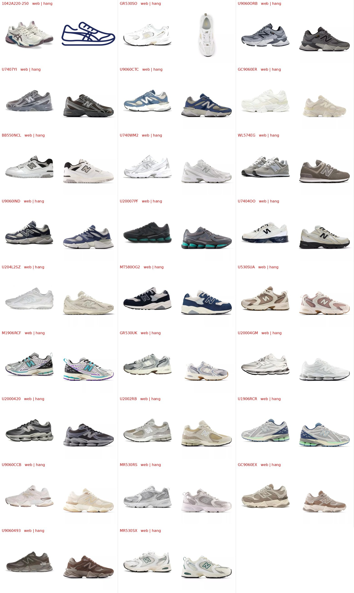

# Ảnh bìa cần chủ shop xem (19/10)

Ngày 19/10 ảnh bìa New Balance, Asics, Onitsuka Tiger được thay bằng ảnh chính hãng (kho ảnh của hãng, tra đúng mã, 1200px).
26 mẫu dưới đây **chưa thay**, vì ảnh của hãng khác màu / khác góc so với ảnh trong bảng hàng — có thể ảnh trong bảng
bị nhầm, hoặc mã ghi nhầm.

Cách duyệt: mở `scripts/anh-khong-tai.txt`, **xoá dòng** của mẫu mà ảnh hãng (bên phải) đúng với đôi bạn có, rồi nhờ trợ lý
chạy `python scripts/tai_anh_hang.py --ma <MÃ>` và đưa lên web. Mẫu ảnh hãng sai thì giữ nguyên dòng (web giữ ảnh cũ),
và kiểm tra lại mã trong bảng hàng.

- `1042A220-250`: kho ảnh hãng chỉ có hình vẽ minh hoạ.
- `GR530SO`: hãng chỉ có ảnh chụp từ trên xuống.
